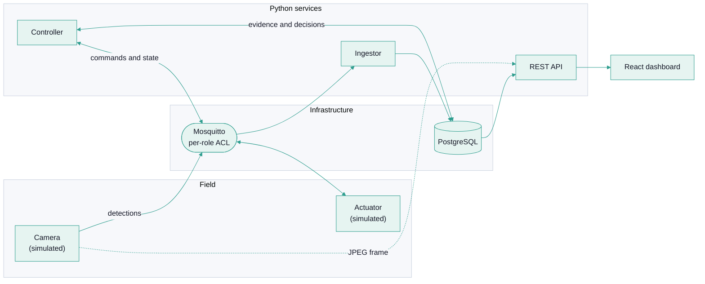

<div align="center">

<picture>
  <source media="(prefers-color-scheme: dark)" srcset="assets/brand/banner-dark.svg">
  
</picture>

<p><a href="README.md">Português</a> · <strong>English</strong></p>

<h3>Measures, with data, what actually keeps pigeons away.</h3>

<p>
A camera detects, a controller decides and a low-energy actuator reacts,<br>
always inside safety limits that the software cannot exceed.<br>
Every activation becomes data for a controlled experiment.
</p>

<p>
  <a href="https://github.com/ADSLustosa/pigeondome/actions/workflows/ci.yml"></a>
  
  
  
  
</p>

<p>
  <a href="#overview">Overview</a> ·
  <a href="#how-it-works">How it works</a> ·
  <a href="#layered-safety">Safety</a> ·
  <a href="#dashboard">Dashboard</a> ·
  <a href="#running-locally">Run</a> ·
  <a href="#stack">Stack</a> ·
  <a href="#roadmap">Roadmap</a> ·
  <a href="#license">License</a>
</p>

</div>

> [!IMPORTANT]
> **Status: simulated prototype.** The camera and the actuator are simulated in software. No device that emits an electromagnetic field has been built or tested, and **there is no evidence yet that the method keeps pigeons away**: that is what the project's A/B experiment will measure. Do not use this software to control real hardware without a professional electrical-safety assessment and legal compliance review.

## Overview

Pigeon control is usually done without measurement: a deterrent is installed and nobody knows whether it worked. Pigeondome closes the loop. It **measures** bird presence, **decides** when to act, **activates** an actuator with hard limits and **compares** the periods with and without activation.

| | |
|---|---|
| **Measurement** | The camera, simulated for now, publishes counts over MQTT. The ingestor validates each message against a JSON Schema contract and stores it in PostgreSQL idempotently. |
| **Decision** | A pure, tested policy requires minimum evidence and respects a minimum interval, a daily budget and quiet hours. There are four modes: off, dry run, live and experiment. |
| **Safe actuation** | The actuator has its own limits (maximum pulse, minimum pause, hourly budget and watchdog) that no command can change. |
| **Experiment** | In experiment mode, randomly drawn time blocks receive no activation. They are the control group of the comparison. |
| **Dashboard** | Controller and actuator state, kill switch, decision trail and live camera, responsive from 320 px. |
| **API** | REST with RFC 9457 errors and OpenAPI documentation. The only possible write is turning the kill switch on. |

## How it works



1. **Detect.** The camera publishes the pigeon count over MQTT. The ingestor validates the message and stores it.
2. **Decide.** The controller reads recent evidence and applies the policy. Every activation, and every change of reason, is recorded with its cause.
3. **Act.** If everything allows it, it sends a short-lived command. The actuator checks its own limits and answers with state and events.
4. **Show.** The API reads the database and the dashboard displays state, trail and camera.

## Layered safety

The software that decides and the software that activates never trust each other: every layer protects itself.

| Layer | Where | What it guarantees |
|---|---|---|
| **1. Kill switch** | database, read on every step | With the switch on, the controller sends nothing. Without a reliable answer, it counts as "on". The API can only turn it **on**; turning it off requires access to the database machine. |
| **2. Dry run by default** | controller | Decides and records, but sends no commands until live mode is requested. |
| **3. Policy** | controller | Minimum evidence, minimum interval, daily budget and quiet hours. Stale data or an unavailable actuator means no action. |
| **4. Command contract** | JSON Schema | Expiry of 1 to 30 s, unique identifier and **no power or voltage parameter**. |
| **5. Actuator limits** | actuator (the simulator for now) | Pulse of at most 10 s, minimum pause of 30 s, budget of 120 s per hour and a 5 s watchdog. They are actuator constants, not command parameters. |
| **6. Safe state** | MQTT broker | If the actuator dies, the broker publishes "offline" and the controller stops commanding. |
| **7. Physical protection** | hardware (planned) | Normally-open relay and a hardware watchdog. Software alone is not a safeguard. |

## Dashboard

Stale data never looks current: an offline actuator is shown as offline, one without recent messages as "no signal", and a controller without a heartbeat as "stopped". If the API itself goes down, the cards fade and warn that they show the last received state.

## Running locally

> [!NOTE]
> Running the software requires the owner's authorization (see [License](#license)). This section documents the project's environment.

**Prerequisites:** Windows with PowerShell, Docker Desktop, Python 3.12 or later, Node.js 24 and Git. The run scripts are PowerShell.

```powershell
git clone https://github.com/ADSLustosa/pigeondome.git
cd pigeondome
python -m venv .venv
.\.venv\Scripts\Activate.ps1
pip install -e "backend[dev]" -e "simulator[dev]"
.\infra\setup.ps1
cd dashboard
npm ci
cd ..
```

`infra\setup.ps1` prepares the local infrastructure (PostgreSQL and Mosquitto in Docker containers, with local credentials). Then, one terminal per service, with the `.venv` active:

| Service | Command | What it does |
|---|---|---|
| Ingestor | `.\scripts\run-backend.ps1` | Receives detections and stores them. |
| Camera | `.\scripts\run-simulator.ps1 -Hour 8 -IntervalSeconds 2` | Publishes detections and serves the simulated frame. |
| Actuator | `.\scripts\run-actuator.ps1` | Simulated actuator with the safety limits. |
| Controller | `.\scripts\run-controller.ps1` | Dry run. With `-Mode live`, it sends pulses to the simulated actuator. |
| API | `.\scripts\run-api.ps1` | REST at `http://127.0.0.1:8000`, documented at `/docs`. |
| Dashboard | `cd dashboard` then `npm run dev` | Dashboard at `http://127.0.0.1:5173`. |

`-Hour 8` forces the hour used by the simulator's presence model. The per-hour pattern is a modeling assumption and will be replaced by the baseline measured at the installation. If port 8000 is taken by another program, use `.\scripts\run-api.ps1 -Port 8001` and set `VITE_API_URL` for the dashboard.

Helper tools: `.\scripts\kill-switch.ps1 status|on|off` (the kill switch), `.\scripts\actuator-console.ps1 pulse|stop|watch` (manual commands) and `.\scripts\show-decisions.ps1` (the trail in the terminal).

Tests: `pytest` in `backend/` (database integration uses `PIGEONDOME_TEST_DSN`) and in `simulator/`, and `npm test` in `dashboard/`.

## Stack

| Layer | Technologies |
|---|---|
| Messaging | MQTT with Eclipse Mosquitto, per-role ACL, `paho-mqtt` |
| Backend | Python 3.12+, FastAPI, psycopg 3 with pool, Pydantic, JSON Schema |
| Data | PostgreSQL, versioned SQL migrations applied under a lock |
| Dashboard | React 19, TypeScript, Vite, Vitest |
| Simulation | Python, Pillow (simulated frames) |
| Quality | ruff, strict mypy, pytest, ESLint, pre-commit with gitleaks, GitHub Actions |
| Target hardware | ESP32 (planned) |

## Structure

```text
pigeondome/
├── backend/     ingestor, controller and API (Python)
├── simulator/   simulated camera and actuator
├── dashboard/   React dashboard
├── contracts/   JSON Schema contracts for the MQTT messages
├── infra/       Docker Compose (PostgreSQL, Mosquitto) and ACL
├── scripts/     local execution (PowerShell)
└── assets/      visual identity and images used by this README
```

## Quality

- **Hexagonal architecture.** The domain (policy, records, data freshness) is pure: no database, no network and no clock. MQTT, PostgreSQL and HTTP are adapters.
- **Versioned contracts.** Messages have JSON Schemas, and tests check producers and consumers against them.
- **Contract tests on two adapters.** The same tests run against the in-memory version and against PostgreSQL.
- **Property-based testing.** The actuator core is tested with random inputs to prove its limits are never exceeded.
- **Required checks.** Three CI checks (backend, simulator and dashboard) protect `main`; lint, strict types and secret scanning run before every commit.
- **Standard errors.** The API answers errors as `application/problem+json` (RFC 9457) and never returns internal details.

## Privacy

The database stores device identifiers, counts, decisions and reasons: no personal data. The camera image, once real, is not written to disk or to the database: it passes through the API and lives only in the browser's memory. A camera in a residential area can capture identifiable people, so the API currently answers only on `127.0.0.1`, and authentication is a prerequisite before any network exposure.

## Roadmap

- [x] Versioned MQTT contracts and idempotent ingestion
- [x] Decision policy with dry-run, live and experiment modes
- [x] Simulated actuator with safety limits and property-based tests
- [x] Controller with an audit trail
- [x] Read API and responsive dashboard with a simulated live camera
- [ ] A/B experiment report (treatment versus control)
- [ ] Hardening: actuator budget in non-volatile memory, events recorded by an independent process, broker TLS and API authentication
- [ ] Technical documentation in `docs/`
- [ ] Hardware: bill of materials, electrical design and standards assessment
- [ ] Real on-device pigeon detector

## License

The source code is available for **viewing**. This project is **neither free nor open-source software**: all rights are reserved. Running, copying, modifying or distributing it requires the owner's written authorization or a purchase. Details, and the licensing history, in [`LICENSE`](LICENSE).

For commercial licensing, reach out on [LinkedIn](https://www.linkedin.com/in/adslustosa).

<div align="center">

<sub>A project by <a href="https://github.com/ADSLustosa">@ADSLustosa</a> · <a href="https://www.linkedin.com/in/adslustosa">LinkedIn</a></sub>

</div>
