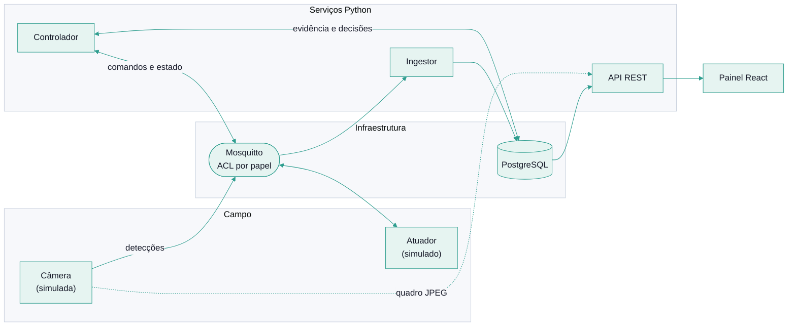
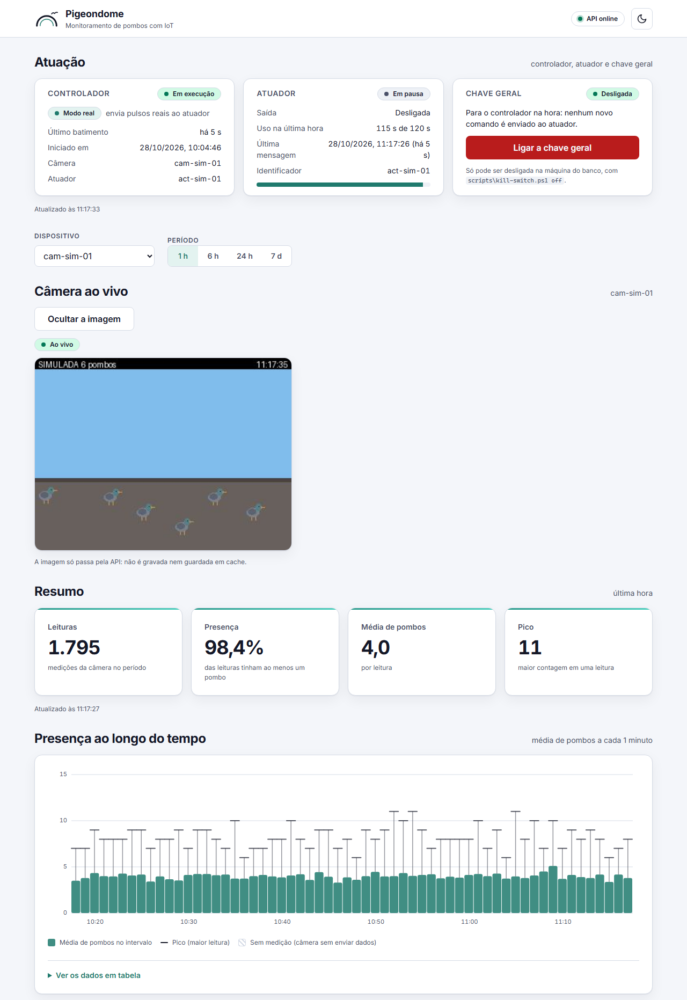
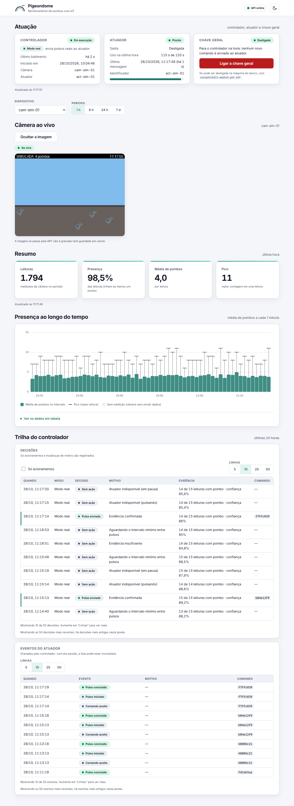
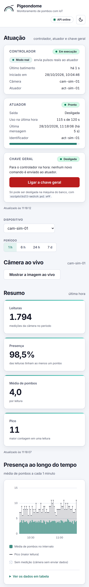

<div align="center">

<picture>
  <source media="(prefers-color-scheme: dark)" srcset="assets/brand/banner-dark.svg">
  
</picture>

<p><strong>Português</strong> · <a href="README.en.md">English</a></p>

<h3>Mede, com dados, o que realmente afasta pombos.</h3>

<p>
Uma câmera detecta, um controlador decide e um atuador de baixa energia reage,<br>
sempre dentro de limites de segurança que o software não consegue ultrapassar.<br>
Cada acionamento vira dado para um experimento controlado.
</p>

<p>
  <a href="https://github.com/ADSLustosa/pigeondome/actions/workflows/ci.yml"></a>
  
  
  
  
</p>

<p>
  <a href="#visão-geral">Visão geral</a> ·
  <a href="#como-funciona">Como funciona</a> ·
  <a href="#segurança-por-camadas">Segurança</a> ·
  <a href="#painel">Painel</a> ·
  <a href="#executar-localmente">Executar</a> ·
  <a href="#stack">Stack</a> ·
  <a href="#roadmap">Roadmap</a> ·
  <a href="#licença">Licença</a>
</p>

</div>

> [!IMPORTANT]
> **Status: protótipo simulado.** A câmera e o atuador são simulados por software. Nenhum dispositivo que emita campo eletromagnético foi construído ou testado, e **ainda não existe evidência de que o método afaste pombos**: é isso que o experimento A/B do projeto vai medir. Não use este software para controlar hardware real sem avaliação profissional de segurança elétrica e de conformidade legal.

## Visão geral

Controle de pombos costuma ser feito sem medição: instala-se um dissuasor e ninguém sabe se funcionou. O Pigeondome fecha o ciclo. Ele **mede** a presença das aves, **decide** quando agir, **aciona** um atuador com limites rígidos e **compara** os períodos com e sem acionamento.

| | |
|---|---|
| **Medição** | A câmera, hoje simulada, publica contagens por MQTT. O ingestor valida cada mensagem contra um contrato JSON Schema e grava no PostgreSQL de forma idempotente. |
| **Decisão** | Uma política pura e testada exige evidência mínima, respeita intervalo mínimo, orçamento diário e horário de silêncio. Há quatro modos: desligado, seco, real e experimento. |
| **Atuação segura** | O atuador tem limites próprios (pulso máximo, pausa mínima, orçamento por hora e watchdog) que nenhum comando consegue alterar. |
| **Experimento** | No modo experimento, blocos de horário sorteados ficam sem acionamento. Eles são o grupo de controle da comparação. |
| **Painel** | Estado do controlador e do atuador, chave geral, trilha de decisões e câmera ao vivo, responsivo a partir de 320 px. |
| **API** | REST com erros no formato RFC 9457 e documentação OpenAPI. A única escrita possível é ligar a chave geral. |

## Como funciona



1. **Detectar.** A câmera publica a contagem de pombos por MQTT. O ingestor valida a mensagem e grava no banco.
2. **Decidir.** O controlador lê a evidência recente e aplica a política. Todo acionamento, e toda mudança de motivo, é registrado com a razão.
3. **Agir.** Se tudo permite, ele envia um comando com validade curta. O atuador confere os próprios limites e responde com estado e eventos.
4. **Mostrar.** A API lê o banco e o painel exibe o estado, a trilha e a câmera.

## Segurança por camadas

O software que decide e o software que aciona nunca confiam um no outro: cada camada se protege sozinha.

| Camada | Onde | O que garante |
|---|---|---|
| **1. Chave geral** | banco de dados, lida a cada passo | Com a chave ligada, o controlador não envia nada. Sem resposta confiável, vale "ligada". A API só consegue **ligar** a chave; desligar exige acesso à máquina do banco. |
| **2. Modo seco por padrão** | controlador | Decide e registra, mas não envia comandos até que o modo real seja pedido. |
| **3. Política** | controlador | Evidência mínima, intervalo mínimo, orçamento diário e horário de silêncio. Dado velho ou atuador indisponível significa nenhuma ação. |
| **4. Contrato do comando** | JSON Schema | Validade de 1 a 30 s, identificador único e **nenhum parâmetro de potência ou tensão**. |
| **5. Limites do atuador** | atuador (hoje o simulador) | Pulso de no máximo 10 s, pausa mínima de 30 s, orçamento de 120 s por hora e watchdog de 5 s. São constantes do atuador, não parâmetros do comando. |
| **6. Estado seguro** | broker MQTT | Se o atuador cai, o broker publica "offline" e o controlador para de comandar. |
| **7. Proteção física** | hardware (planejada) | Relé normalmente aberto e watchdog em hardware. Software sozinho não é uma proteção. |

## Painel

<p align="center">
  <picture>
    <source media="(prefers-color-scheme: dark)" srcset="assets/screenshots/painel-escuro.png">
    
  </picture>
</p>

<p align="center"><sub>Dados simulados. As capturas não contêm imagem real nem dado pessoal.</sub></p>

<details>
<summary><b>Painel completo: trilha de decisões e eventos do atuador</b></summary>

<p align="center">
  <picture>
    <source media="(prefers-color-scheme: dark)" srcset="assets/screenshots/painel-completo-escuro.png">
    
  </picture>
</p>

</details>

<details>
<summary><b>Versão para celular</b></summary>

<p align="center">
  <picture>
    <source media="(prefers-color-scheme: dark)" srcset="assets/screenshots/painel-movel-escuro.png">
    
  </picture>
</p>

</details>

Dado velho nunca parece atual: um atuador offline é mostrado como offline, um sem mensagens recentes como "sem sinal", e um controlador sem batimento como "parado". Se a própria API cair, os cartões esmaecem e avisam que mostram o último estado recebido.

## Executar localmente

> [!NOTE]
> Executar o software exige autorização do titular (veja [Licença](#licença)). Esta seção documenta o ambiente do projeto.

**Pré-requisitos:** Windows com PowerShell, Docker Desktop, Python 3.12 ou superior, Node.js 24 e Git. Os scripts de execução são PowerShell.

```powershell
git clone https://github.com/ADSLustosa/pigeondome.git
cd pigeondome
python -m venv .venv
.\.venv\Scripts\Activate.ps1
pip install -e "backend[dev]" -e "simulator[dev]"
.\infra\setup.ps1
cd dashboard
npm ci
cd ..
```

O `infra\setup.ps1` prepara o ambiente local de infraestrutura (PostgreSQL e Mosquitto em contêineres Docker, com credenciais locais). Depois, um terminal para cada serviço, com o `.venv` ativo:

| Serviço | Comando | O que faz |
|---|---|---|
| Ingestor | `.\scripts\run-backend.ps1` | Recebe as detecções e grava no banco. |
| Câmera | `.\scripts\run-simulator.ps1 -Hour 8 -IntervalSeconds 2` | Publica detecções e serve o quadro simulado. |
| Atuador | `.\scripts\run-actuator.ps1` | Atuador simulado, com os limites de segurança. |
| Controlador | `.\scripts\run-controller.ps1` | Modo seco. Com `-Mode live`, envia pulsos ao atuador simulado. |
| API | `.\scripts\run-api.ps1` | REST em `http://127.0.0.1:8000`, com a documentação em `/docs`. |
| Painel | `cd dashboard` e `npm run dev` | Painel em `http://127.0.0.1:5173`. |

`-Hour 8` força a hora usada pelo modelo de presença do simulador. O padrão por horário é uma suposição de modelagem e será substituído pela linha de base medida na instalação. Se a porta 8000 estiver ocupada por outro programa, use `.\scripts\run-api.ps1 -Port 8001` e defina `VITE_API_URL` para o painel.

Ferramentas de apoio: `.\scripts\kill-switch.ps1 status|on|off` (a chave geral), `.\scripts\actuator-console.ps1 pulse|stop|watch` (comandos manuais) e `.\scripts\show-decisions.ps1` (a trilha no terminal).

Testes: `pytest` em `backend/` (a integração com banco usa `PIGEONDOME_TEST_DSN`) e em `simulator/`, e `npm test` em `dashboard/`.

## Stack

| Camada | Tecnologias |
|---|---|
| Mensageria | MQTT com Eclipse Mosquitto, ACL por papel, `paho-mqtt` |
| Backend | Python 3.12+, FastAPI, psycopg 3 com pool, Pydantic, JSON Schema |
| Dados | PostgreSQL, migrações SQL versionadas e aplicadas com trava |
| Painel | React 19, TypeScript, Vite, Vitest |
| Simulação | Python, Pillow (quadros simulados) |
| Qualidade | ruff, mypy estrito, pytest, ESLint, pre-commit com gitleaks, GitHub Actions |
| Hardware-alvo | ESP32 (planejado) |

## Estrutura

```text
pigeondome/
├── backend/     ingestor, controlador e API (Python)
├── simulator/   câmera e atuador simulados
├── dashboard/   painel React
├── contracts/   contratos JSON Schema das mensagens MQTT
├── infra/       Docker Compose (PostgreSQL, Mosquitto) e ACL
├── docs/        documentação técnica, decisões e guia de marca
├── scripts/     execução local (PowerShell)
└── assets/      identidade visual e imagens deste README
```

## Qualidade

- **Arquitetura hexagonal.** O domínio (política, registros, frescor dos dados) é puro: sem banco, sem rede e sem relógio. MQTT, PostgreSQL e HTTP são adaptadores.
- **Contratos versionados.** As mensagens têm JSON Schema, e testes conferem produtores e consumidores contra eles.
- **Testes de contrato em dois adaptadores.** Os mesmos testes rodam contra a versão em memória e contra o PostgreSQL.
- **Teste aleatório reprodutível.** O núcleo do atuador é exercitado com milhares de entradas aleatórias, geradas por semente, e a cada passo as invariantes de segurança são conferidas.
- **Verificações obrigatórias.** Três verificações de CI (backend, simulador e painel) protegem a `main`; lint, tipos estritos e busca de segredos rodam antes de cada commit.
- **Erros padronizados.** A API responde erros em `application/problem+json` (RFC 9457) e nunca devolve detalhes internos.

## Privacidade

O banco guarda identificadores de dispositivos, contagens, decisões e motivos: nenhum dado pessoal. A imagem da câmera, quando for real, não é gravada em disco nem em banco: ela passa pela API e fica só na memória do navegador. Uma câmera em área residencial pode captar pessoas identificáveis, então a API hoje responde apenas em `127.0.0.1`, e a autenticação é pré-requisito antes de qualquer exposição na rede.

## Roadmap

- [x] Contratos MQTT versionados e ingestão idempotente
- [x] Política de decisão com modos seco, real e experimento
- [x] Atuador simulado com limites de segurança e teste aleatório reprodutível
- [x] Controlador com trilha de auditoria
- [x] API de leitura e painel responsivo com câmera simulada ao vivo
- [ ] Relatório do experimento A/B (tratamento contra controle)
- [ ] Endurecimento: orçamento do atuador em memória não volátil, eventos gravados por processo independente, TLS no broker e autenticação da API
- [x] Documentação técnica em [`docs/`](docs/README.md)
- [ ] Hardware: lista de materiais, projeto elétrico e avaliação normativa
- [ ] Detector real de pombos no dispositivo de borda

## Segurança e participação

- Encontrou uma falha? Relate de forma **privada**, conforme a [política de segurança](SECURITY.md).
- Erros e ideias entram por [issues](https://github.com/ADSLustosa/pigeondome/issues/new/choose). Pull requests de código de terceiros não são aceitos, veja o [guia de participação](CONTRIBUTING.md).
- As mudanças relevantes estão no [histórico de mudanças](CHANGELOG.md).

## Licença

O código-fonte está disponível para **consulta**. Este projeto **não é software livre nem de código aberto**: todos os direitos são reservados. Executar, copiar, modificar ou distribuir exige autorização escrita do titular ou compra. Detalhes, e o histórico de licenciamento, em [`LICENSE`](LICENSE).

Para licenciamento comercial, fale pelo [LinkedIn](https://www.linkedin.com/in/adslustosa).

<div align="center">

<sub>Projeto de <a href="https://github.com/ADSLustosa">@ADSLustosa</a> · <a href="https://www.linkedin.com/in/adslustosa">LinkedIn</a></sub>

</div>
