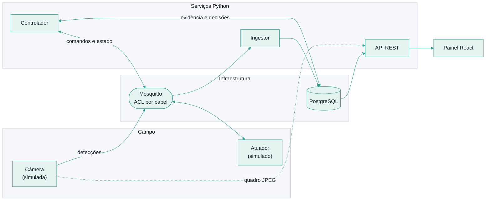

# Arquitetura

O Pigeondome é um laço fechado: **detectar, decidir, agir, registrar**. Cada etapa é um processo independente que conversa com os outros por mensagens MQTT ou pelo banco de dados, e nenhum confia cegamente no outro.

## Visão geral



## Processos

| Processo | Papel MQTT | Entrada | Saída |
|---|---|---|---|
| **Câmera simulada** | `camera` | modelo de presença por horário | detecções e status no broker; quadro JPEG em HTTP local |
| **Ingestor** | `backend` | detecções do broker | linhas na tabela `detections` |
| **Controlador** | `backend` | leituras do banco, estado do atuador, chave geral | comandos ao atuador; decisões, eventos e batimento no banco |
| **Atuador simulado** | `actuator` | comandos do broker | estado e eventos no broker |
| **API** | não usa MQTT | banco de dados e o quadro da câmera | JSON e o quadro JPEG para o painel |
| **Painel** | nenhum | a API | tela |

O ingestor e o controlador compartilham o mesmo papel MQTT (`backend`) porque as regras de acesso se aplicam por papel. A API nem entra no broker: ela só lê o banco.

## Arquitetura hexagonal no backend

O backend separa o que **decide** do que **conversa com o mundo**:

```text
backend/src/pigeondome/
├── domain/        regras puras: política, registros, frescor dos dados, quadro da câmera
├── application/   casos de uso e as portas (interfaces) que o domínio precisa
└── adapters/      MQTT, PostgreSQL, HTTP (API) e a versão em memória de cada porta
```

- O **domínio** não importa banco, rede nem relógio. O tempo entra como parâmetro, então cada regra é testada de forma determinística.
- A **aplicação** define portas, por exemplo `DetectionRepository` e `DecisionRepository`.
- Cada porta tem **dois adaptadores**: PostgreSQL e memória. Os mesmos testes de contrato rodam nos dois, o que garante que a versão em memória usada nos testes se comporta como o banco de verdade.

A mesma ideia vale no simulador: o núcleo do atuador (`actuator_core.py`) é uma máquina de estados pura, e o serviço MQTT em volta dele só traduz mensagens.

## Como um passo do controlador decide

A cada ciclo (padrão de 1 s, em `CONTROLLER_TICK_S`), o controlador:

1. lê do banco as leituras da câmera na janela recente;
2. lê a chave geral e conta os pulsos do dia;
3. aplica a política em **ordem fixa**, e a primeira regra que se aplica vence;
4. se o veredito for acionar, envia o comando ao atuador;
5. grava a decisão com o motivo e as evidências.

A ordem das regras importa: as que **impedem** vêm antes, e o modo seco fica por último, para registrar exatamente o que o modo real faria.

| # | Motivo (`reason`) | Quando impede |
|---|---|---|
| 1 | `mode_off` | modo desligado |
| 2 | `kill_switch` | chave geral ligada |
| 3 | `stale_data` | leitura mais recente com mais de 15 s (ou nenhuma) |
| 4 | `insufficient_evidence` | menos de 3 leituras com pombo na janela de 30 s, confiança média abaixo de 0,7, ou a mais recente sem pombo |
| 5 | `quiet_hours` | dentro da janela de silêncio configurada |
| 6 | `actuator_unavailable` | atuador offline, sem relato recente (mais de 30 s) ou fora do estado `idle` |
| 7 | `retry_gap` | último pulso há menos de 120 s |
| 8 | `daily_budget` | 40 pulsos no dia local |
| 9 | `experiment_control` | modo experimento, e este bloco de horas é de controle |
| 10 | `dry_run` | modo seco: registra `would_pulse` e não envia nada |
| 11 | `evidence_confirmed` | tudo permite: envia o pulso |

Os valores acima são os padrões de `PolicyConfig` e podem ser ajustados por variáveis de ambiente (veja [Operação](operacao.md)). Quando um parâmetro foge do que o atuador aceita (por exemplo, um pulso de mais de 10 s), a configuração é recusada na partida.

## Idempotência

O MQTT com QoS 1 pode entregar a mesma mensagem mais de uma vez. Por isso toda gravação usa chave primária natural, e repetir a mensagem não duplica a linha:

- `detections`: `(device_id, detected_at)`;
- `actuation_decisions`: `(actuator_id, camera_id, decided_at)`;
- `actuator_events`: `(actuator_id, occurred_at, event)`.

O atuador, por sua vez, descarta comandos repetidos pelo `command_id`.

## Dados no banco

| Tabela | Conteúdo |
|---|---|
| `detections` | contagem de pombos e confiança por câmera e instante |
| `actuation_decisions` | cada decisão do controlador, com motivo, evidências e braço do experimento |
| `actuator_events` | aceitação, recusa, início, fim e interrupção de pulsos |
| `controller_flags` | uma linha: a chave geral |
| `actuator_state` | último estado conhecido de cada atuador |
| `controller_status` | uma linha: modo, início e batimento do controlador |

As migrações são arquivos SQL numerados em `backend/src/pigeondome/migrations/`, aplicados na partida dos serviços. Veja [Privacidade e LGPD](privacidade-e-lgpd.md) para o que cada tabela guarda.

## Frescor dos dados

O painel não pode mostrar um dado velho como se fosse atual. As regras estão em `domain/freshness.py`:

- O momento que vale é o da **recepção**, pelo relógio do controlador, e não o `reported_at` que o dispositivo informa. Assim um relógio errado no dispositivo não esconde uma queda.
- Um atuador `online` sem mensagem há mais de 30 s é **sem sinal** (dado velho).
- Um atuador `offline` é um **fato**, informado pelo aviso de última vontade do broker, e não é tratado como velho.
- O controlador está rodando se o último batimento tem até 15 s (ele grava a cada 5 s).

## Decisões registradas

As escolhas de maior impacto têm um registro curto em [`decisoes/`](decisoes/README.md).
