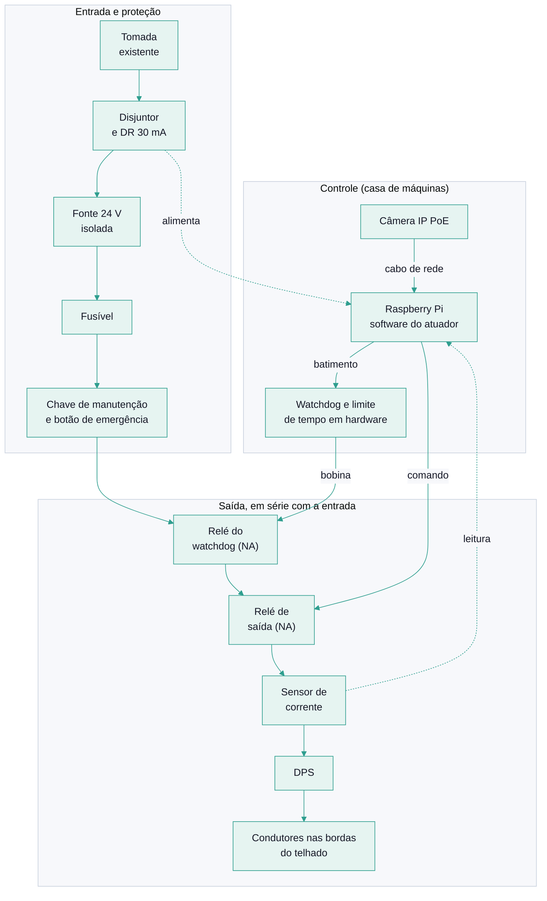

# Dossiê para o eletricista: instalação de teste

> [!IMPORTANT]
> Este documento é uma **proposta de projeto**, escrita para ser avaliada, corrigida e assumida por um profissional habilitado. Não é projeto elétrico, laudo nem ART. Nenhum item abaixo foi revisado por engenheiro ou técnico. Onde o profissional discordar, **vale a decisão dele**.

## 1. Resumo

O Pigeondome detecta pombos por câmera e, só quando há detecção, energiza condutores de **baixa tensão** instalados nas bordas do telhado, por no máximo 10 segundos de cada vez. O objetivo é desestimular o pouso sobre as placas solares. A instalação é um **teste**: o sistema mede o resultado (experimento A/B) e pode ser desligado a qualquer momento.

| | Quem |
|---|---|
| Rede elétrica, proteções, fonte, relés, condutores, aterramento, DPS, cabeamento | **Eletricista** (com a responsabilidade técnica que ele julgar necessária) |
| Software do atuador, detector, câmera (configuração), painel | **Proprietário** |
| Fixação sem comprometer o arranjo fotovoltaico | **Eletricista, com o instalador das placas** |

A tensão proposta é de **24 V em corrente contínua**, de uma fonte isolada, que a NBR 5410 deve enquadrar como extrabaixa tensão (a confirmar pelo profissional).

## 2. Premissas informadas pelo proprietário

| Item | Informação |
|---|---|
| Área de interesse | Cerca de 150 a 180 m² |
| Posição dos condutores | Nas bordas e **perpendiculares a elas**, para impedir o pouso sobre as placas solares |
| Comprimento total de condutor | **A definir no croqui.** O perímetro da casa, medido no mapa, é de cerca de 61 m; com os elementos perpendiculares, o dimensionamento preliminar considera **até 150 m** |
| Alimentação | Existe tomada na casa de máquinas e sistema hidráulico, no teto |
| Alcance | O fio não fica ao alcance de pessoas |
| Rede | O roteador fica no térreo e no primeiro andar, com bom sinal nesses pavimentos. **O sinal na casa de máquinas não foi medido** |
| Câmera | Ainda não adquirida |

## 3. O que precisa ser confirmado antes de comprar qualquer coisa

Perguntas ao eletricista, em ordem de importância:

1. **Placas solares.** Qual o modelo do inversor e a tensão das strings? Quem instalou, e a garantia é afetada por fixar algo no telhado ou perto das placas? O inversor monitora isolação ou fuga à terra? Como o circuito de 24 V deve ser isolado para não causar alarme ou fuga?
2. **Descargas atmosféricas.** Existe SPDA (para-raios) e equipotencialização? Condutores metálicos longos no telhado captam surtos: onde ligar o DPS e como se relacionam com o SPDA existente?
3. **Tomada da casa de máquinas.** Em que circuito está, com qual disjuntor, DR e aterramento? Há capacidade para a carga adicional? É preciso circuito dedicado?
4. **Referência da fonte.** O negativo da fonte de 24 V deve ficar flutuante ou aterrado?
5. **Limite de corrente na saída.** Qual valor máximo atende ao critério de segurança tanto para o contato de uma ave quanto para um contato acidental de pessoa (limpeza das placas, manutenção)? Esse valor será medido em bancada, com carga de teste.
6. **Condutores e fixação.** Material (aço inox é a proposta), isoladores e suportes resistentes a UV, forma de fixar sem furar a moldura das placas, dilatação térmica e vento.
7. **Trabalho em altura.** Pontos de ancoragem existentes para a NR-35. Quem instala e quem faz manutenção usa qual procedimento?
8. **Rotas.** Caminho dos cabos entre a casa de máquinas e as bordas, eletrodutos e proteção contra intempérie.
9. **Rede.** O Wi-Fi alcança a casa de máquinas? Se não, qual o caminho para um cabo de rede, que também alimentaria a câmera?

**Tarefas do proprietário antes da visita:**

- Medir o sinal de Wi-Fi na casa de máquinas com o celular.
- Fotografar o telhado, as placas, a placa de identificação do inversor, o quadro elétrico e a tomada da casa de máquinas.
- Fazer um croqui simples do telhado, marcando as bordas, as placas, a casa de máquinas e onde os pombos pousam.

## 4. Arquitetura elétrica proposta

No desenho, a energia segue da entrada (em cima) para a saída (no meio), e o quadro de baixo é o controle. **A ideia central é a cadeia de segurança em série.** Para a saída ficar energizada, todos estes elementos precisam permitir ao mesmo tempo:

1. a **chave de manutenção** (corte físico, com chave) e o **botão de emergência** estarem liberados;
2. o **relé do watchdog** estar fechado, o que só acontece enquanto o software envia um batimento periódico;
3. o **relé de saída** estar fechado, por comando do software.

Os dois relés têm contato **normalmente aberto** (sem energia, a saída abre). Assim, travamento do processador, queda de energia, queda da rede ou fim do pulso resultam em saída desligada. O software já impõe esses limites; o hardware existe para que **uma falha do software não seja capaz de manter a saída ligada**.

## 5. Requisitos de segurança

Cada requisito deve ser verificado no comissionamento (seção 8).

| # | Requisito |
|---|---|
| R1 | Tensão de saída máxima de 24 V DC, de fonte com isolação galvânica entre a rede e o circuito dos condutores. |
| R2 | Sem energia ou com qualquer falha, a saída abre (relés com contato NA, lógica à prova de falha). |
| R3 | Watchdog em hardware, independente do software. Proposta inicial: abre a saída se não receber batimento em **2 s**. |
| R4 | Limite de tempo contínuo de energização em hardware. Proposta inicial: **12 s**, contra 10 s do software, para que um travamento com o batimento ainda ativo não mantenha a saída ligada. |
| R5 | Chave de manutenção com chave, que corta fisicamente o caminho da saída, e botão de emergência acessível na casa de máquinas. |
| R6 | Limite de corrente na saída, com valor definido em bancada e aprovado pelo eletricista. |
| R7 | Fusível na saída DC, e proteção (disjuntor e DR de 30 mA) a montante da fonte. |
| R8 | Medição da corrente de saída. Corrente acima do limite ou sinal de fuga (por exemplo, isoladores molhados) desliga a saída e gera um alerta. |
| R9 | DPS na linha que sai para o telhado, com aterramento coordenado com o SPDA existente. |
| R10 | Condutores fora do alcance de pessoas, com sinalização de aviso nos acessos ao telhado e na casa de máquinas. |
| R11 | Conjunto de controle em caixa com proteção adequada à casa de máquinas (umidade, calor, vibração das bombas). |
| R12 | Queda de rede, Wi-Fi ou broker resulta em saída desligada. Isto já é garantido pelo software. |

## 6. Riscos específicos de instalar junto de placas solares

- **Strings em corrente contínua de alta tensão.** O circuito de 24 V precisa ficar separado do arranjo fotovoltaico. Não fixar nada nas molduras ou nos trilhos sem a aprovação de quem instalou as placas.
- **Monitoramento do inversor.** Inversores costumam monitorar isolação e fuga à terra. Um circuito mal isolado pode causar alarme ou desarme.
- **Sombreamento.** Condutores sobre ou próximos das células sombreiam e podem causar perda de geração e pontos quentes. Manter os condutores fora da área das células.
- **Descargas e surtos.** Condutores metálicos longos no telhado captam surtos induzidos. Ver pergunta 2 da seção 3.
- **Corrosão galvânica.** Evitar contato entre metais diferentes (por exemplo, aço inox em alumínio das molduras) sem isolação.
- **Intempérie.** Sol, chuva, dilatação e vento: usar materiais resistentes a UV e fixação mecânica dimensionada.
- **Limpeza e manutenção das placas.** Quem for ao telhado precisa desligar o sistema com facilidade (chave de manutenção e aviso). A NR-35 vale para o trabalho em altura.
- **Aves.** O objetivo é desestimular, não ferir. Evitar pontos onde a ave possa ficar presa. Observar se há ninhos com ovos ou filhotes antes da energização.

## 7. Lista de materiais preliminar

Sem marcas e sem preços. As quantidades dependem do croqui e do projeto do eletricista.

| Item | Função |
|---|---|
| Raspberry Pi 4 ou 5, com fonte original e armazenamento de boa durabilidade | Roda o software do atuador, do detector e do controlador |
| Câmera IP externa com PoE (IP66), injetor ou switch PoE, cabo de rede para uso externo e DPS de rede | Imagem do telhado; um único cabo para dados e alimentação |
| Disjuntor dedicado e DR de 30 mA | Proteção a montante (ver pergunta 3) |
| Fonte chaveada 24 V DC, isolada, com limitação de corrente e certificação aplicável | Alimentação da saída |
| Fusível com porta-fusível, nos lados AC e DC | Proteção contra sobrecorrente |
| Relé de saída DC, contato NA, dimensionado para a corrente | Liga e desliga a saída |
| Circuito de watchdog e de limite de tempo em hardware (módulo temporizador) | Requisitos R3 e R4 |
| Chave de manutenção com chave e botão de emergência | Requisito R5 |
| Sensor de corrente (shunt e conversor, ou módulo) | Requisito R8 |
| DPS para a linha do telhado | Requisito R9 |
| Condutor de aço inox, isoladores e suportes poliméricos resistentes a UV, conectores | Condutores nas bordas |
| Cabos, eletrodutos, prensa-cabos, identificação | Instalação |
| Caixa de proteção com trilho DIN, IP65 ou superior | Conjunto de controle |
| Placas de aviso e luz indicadora de estado | Requisito R10 |
| Multímetro, megôhmetro, carga de teste resistiva (por exemplo, de 1 kΩ a 10 kΩ) | Ferramentas de comissionamento |

## 8. Comissionamento

| Fase | O que se faz | Critério para passar |
|---|---|---|
| **F0. Bancada** | Montar o conjunto com carga fictícia, sem fio no telhado. Provocar falhas: matar o processo, travar o software, desligar o Wi-Fi, desligar o broker, tirar a energia, acionar a chave e o botão de emergência. | A saída abre em todos os casos, dentro do tempo previsto (R3, R4). A corrente medida respeita R6. |
| **F1. Instalação sem energia** | Fixar condutores, caixa e cabeamento. Medir continuidade e isolação. | Medições aprovadas pelo eletricista. |
| **F2. Energizado sem pombos** | Ligar o sistema com o controlador em **modo seco** (decide, mas não envia comando). Depois, mandar pulsos manuais curtos pelo console, com o proprietário presente. | Telemetria coerente, sem alarme do inversor, sem aquecimento. |
| **F3. Modo real curto** | Ativar o modo real por períodos curtos, de dia, com alguém observando e a chave geral à mão. Começar por um trecho pequeno da borda. | Nenhuma anomalia por vários dias. |
| **F4. Experimento** | Primeiro semanas de linha de base, sem energizar. Depois, o experimento A/B com blocos de tratamento e controle. | Dados suficientes para decidir. |

**Critério de parada em qualquer fase:** comportamento inesperado, aquecimento, alarme do inversor, ave ferida ou dúvida do eletricista. Desligar a chave de manutenção e a chave geral do sistema, e só retomar após análise.

## 9. Referências a consultar

Lista indicativa, a confirmar pelo profissional:

- ABNT NBR 5410: instalações elétricas de baixa tensão.
- ABNT NBR 5419: proteção contra descargas atmosféricas.
- ABNT NBR 16690: instalações elétricas de arranjos fotovoltaicos.
- ABNT NBR IEC 60335-2-76: segurança de eletrificadores de cerca, como referência de projeto.
- NR-10: segurança em instalações e serviços em eletricidade.
- NR-35: trabalho em altura.
- Documentos do projeto: [Segurança do atuador](../seguranca-do-atuador.md), [Operação](../operacao.md), [Roadmap](../roadmap.md).

## 10. Limites deste documento

- Nenhum valor de corrente, tempo ou dimensão foi validado em bancada. Os números acima são **propostas iniciais**.
- A eficácia do conjunto para afastar pombos **não está provada**. Esse é o objetivo do teste.
- Este documento não avalia a conformidade legal, sanitária ou ambiental da instalação, e não substitui a análise de um profissional habilitado.
