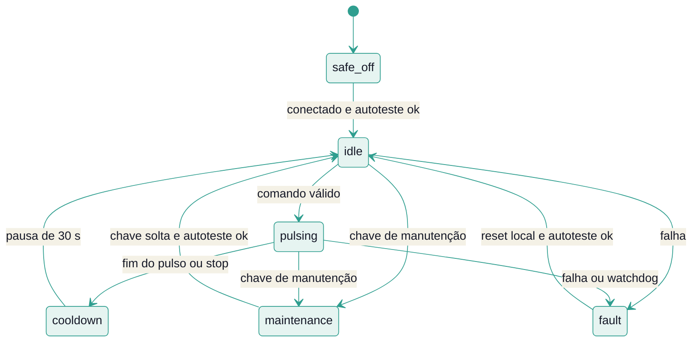

# Segurança do atuador

O atuador é a única peça do sistema que, com hardware real, poderia causar dano físico. O desenho parte de uma regra: **nenhum erro de software, de rede ou de configuração pode manter a saída ligada além de limites fixos**. Cada camada se protege sozinha e não confia na anterior.

> [!IMPORTANT]
> Hoje o atuador é **simulado**. As camadas 1 a 6 existem em software e são testadas. A camada 7, a proteção física, é **planejada** e não existe. Software sozinho não substitui proteção em hardware, e nenhum hardware foi construído ou avaliado. Veja o [roadmap](roadmap.md).

## As sete camadas

| Camada | Onde | O que garante |
|---|---|---|
| **1. Chave geral** | banco de dados | Com a chave ligada, o controlador não envia nada. Sem acesso ao banco ele não decide nada, e se a linha da chave sumir, vale "ligada". A API só consegue **ligar** a chave. |
| **2. Modo seco por padrão** | controlador | Decide e registra, mas não envia comandos até que o modo real seja pedido. |
| **3. Política** | controlador | Evidência mínima, intervalo mínimo, orçamento diário e horário de silêncio. Dado velho ou atuador indisponível significa nenhuma ação. |
| **4. Contrato do comando** | JSON Schema | Validade de 1 a 30 s, identificador único e **nenhum campo de potência, tensão ou corrente**. |
| **5. Limites do atuador** | atuador | Constantes do atuador, que nenhum comando altera (tabela abaixo). |
| **6. Estado seguro** | broker MQTT | Se o atuador cai sem se despedir, o broker publica "offline" e o controlador para de comandar. |
| **7. Proteção física** | hardware (planejada) | Relé normalmente aberto e watchdog em hardware. |

### Camada 1: a chave geral só liga pela API

Parar o sistema é sempre seguro, e rearmá-lo exige presença. Por isso:

- `POST /api/v1/controller/kill-switch` só **liga** a chave e exige o cabeçalho `X-Pigeondome-Action: kill-switch-on`. Um cabeçalho personalizado força o navegador a fazer a checagem prévia de CORS, o que impede que uma página qualquer dispare a ação com um formulário.
- **Desligar** a chave só é possível com acesso à máquina do banco: `.\scripts\kill-switch.ps1 off`.

### Camada 4: o que o comando não consegue pedir

O contrato (`contracts/command.v1.schema.json`) aceita só duas ações, `pulse` e `stop`. Um `pulse` tem duração de 1 a 10 s e validade (`ttl_s`) de 1 a 30 s. **Não existe campo para potência, tensão ou corrente.** O que o atuador entrega durante um pulso é decisão do hardware, não da mensagem.

## Limites do atuador (camada 5)

São constantes do atuador (`Limits`, em `actuator_core.py`), nunca parâmetros de comando:

| Limite | Valor | Efeito |
|---|---|---|
| Pulso máximo | 10 s | Comando com duração maior é recusado (`invalid_command`). |
| Validade máxima do comando | 30 s | Comando vencido é recusado (`expired`). |
| Pausa entre pulsos | 30 s | Novo pulso na pausa é recusado (`cooldown`). |
| Orçamento | 120 s por janela de 3600 s | Pulso que estouraria o orçamento é recusado (`budget_exhausted`). |
| Watchdog | 5 s | Se o laço do atuador ficar mais de 5 s sem rodar durante um pulso, a saída é considerada desligada no prazo e o atuador entra em falha (`watchdog`). |
| Tolerância de relógio | 5 s | Comando "do futuro" além disso é recusado. |
| Relógio válido | a partir de 2026-01-01 | Relógio anterior a isso é falha no autoteste (`clock_invalid`). |
| Memória de comandos | 256 | Comandos repetidos (`command_id`) são recusados (`duplicate`). |

O limite de pulso vale também no controlador: `PolicyConfig` recusa uma duração de mais de 10 s já na partida.

## Máquina de estados

De **qualquer** estado, perder a conexão leva a `safe_off` (por isso a seta não aparece em cada estado).

Regras que valem em qualquer estado:

- A saída (`output_on`) só pode ser verdadeira em `pulsing`. O contrato de estado proíbe qualquer outra combinação, e os testes conferem isso.
- Sem conexão (`safe_off`), a saída está desligada, e um pulso em andamento é interrompido com o motivo `disconnected`.
- **`stop` é sempre aceito**, sem validar validade, repetição nem formato, e interrompe um pulso em andamento.
- Em manutenção ou falha, todo comando é recusado, e um pulso em andamento é interrompido.
- Uma falha só sai com **reset local** (botão físico no hardware), e o primeiro código de falha é mantido.

## Ordem de validação de um `pulse`

O atuador confere, nesta ordem, e a primeira falha encerra com um evento `command_rejected` e o `reason_code` correspondente:

1. campos válidos (identificador, validade de 1 a 30 s, duração de 1 a 10 s);
2. comando não repetido;
3. emitido há pouco (não "do futuro");
4. ainda dentro da validade;
5. atuador conectado, sem falha, fora de manutenção, sem pulso e sem pausa em andamento;
6. orçamento da última hora comporta a duração pedida.

Só então a saída liga, e o atuador emite `command_accepted` e `pulse_started`.

## Como isso é verificado

| O que | Como |
|---|---|
| Regras do núcleo do atuador | Testes unitários determinísticos, com o tempo injetado (`simulator/tests/test_actuator_core.py`). |
| Invariantes sob entradas aleatórias | Teste aleatório (fuzz) reprodutível por semente: 25 sementes de 250 passos, em dois perfis de limites. A cada passo valida estado e eventos contra os contratos e, no fim, reconstrói a linha do tempo da saída (`simulator/tests/test_actuator_fuzz.py`). |
| Contratos | Os mesmos JSON Schemas validam produtores e consumidores. |
| Permissões do broker | Testes leem o arquivo de ACL e conferem que cada papel só tem o que precisa (`backend/tests/test_mosquitto_acl.py`). |
| Chave geral e falha do banco | Testes do controlador e da API conferem que a chave ligada impede o envio e que sem banco não há decisão. |

## Limitações conhecidas

Esta seção existe para que ninguém confie no que o sistema ainda não garante:

- **O orçamento do atuador vive em memória.** Se o atuador reiniciar, o orçamento da última hora volta a zero. Em hardware real precisa ser guardado em memória não volátil.
- **Os eventos são gravados pelo controlador.** Se o controlador estiver parado, os eventos do atuador não chegam ao banco. Falta um registrador independente.
- **O motivo `disconnected` mistura duas situações:** a conexão que cai e o comando que chega com o atuador desconectado.
- **O broker não usa TLS** e a API não tem autenticação. Hoje tudo escuta só em `127.0.0.1`; qualquer exposição na rede exige as duas coisas antes.
- **A proteção física (camada 7) não existe.** Nenhum relé, watchdog em hardware ou limitador de corrente foi projetado.
- **Não houve avaliação de segurança elétrica** por profissional habilitado, nem de conformidade com a legislação ambiental e sanitária aplicável.

Todos estão no [roadmap](roadmap.md).
